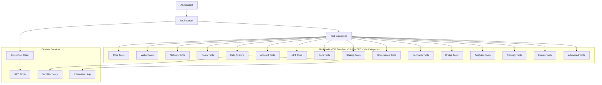

# README Documentation Standard v3.0

## Professional MCP Server Documentation Standard

This document defines the comprehensive README documentation standard for all blockchain MCP servers in the ecosystem. This standard ensures consistent, professional, and user-friendly documentation across all servers while complying with Blockchain MCP Standard v3.0 (BMCPS v3.0) Unified Standard requirements.

---

## 📋 **README Structure Requirements**

### **1. Header Section (REQUIRED)**
```markdown
# {Blockchain} {Network} MCP Server

✅ **Blockchain MCP Standard v3.0 (BMCPS v3.0) Compliant** - A comprehensive Model Context Protocol (MCP) server for {blockchain} {network} blockchain integration with AI systems.

## 🎯 Quick Overview

- **Tool Count**: {actual_tool_count} tools (25 BMCPS v3.0 mandatory + {extended_count} extended tools)
- **Categories**: 16 standardized categories (core, wallet, network, tokens, help, account, nft, defi, staking, governance, contracts, bridge, analytics, security, events, advanced)
- **Network**: {primary_network} (locked to single network - testnet or mainnet only)
- **Architecture**: Blockchain MCP Standard v3.0 (BMCPS v3.0) Unified Standard compliant
- **Compliance Level**: {bronze|silver|gold} - {compliance_description}
- **Test Coverage**: 95%+ enforced with security, chaos & load testing
- **Help System**: Interactive tool discovery and guidance
- **Performance**: Production-ready with comprehensive error handling

## 🏆 Blockchain MCP Standard v3.0 (BMCPS v3.0) Compliance

| Level | Status | Description |
|-------|--------|-------------|
| 🥉 **BRONZE** | ✅ | 24 mandatory tools + basic testing |
| 🥈 **SILVER** | {silver_status} | 40+ tools + extended testing |
| 🥇 **GOLD** | {gold_status} | 100+ tools + production testing |

*Compliance validated with: \`node mbss-v3-validation.js .\`*
```

### **2. Architecture Visualization (REQUIRED)**
Include a Mermaid diagram showing the server architecture:

```markdown
## 🏗️ Server Architecture



**Blockchain MCP Standard v3.0 (BMCPS v3.0) Architecture:**
- **16 Categories**: Modular organization following Blockchain MCP Standard v3.0 (BMCPS v3.0) standard
- **25+ Mandatory Tools**: Core blockchain functionality required for all servers
- **Extended Tools**: Optional advanced features (NFT, DeFi, Cross-chain, etc.)
- **Help System**: Interactive tool discovery and guidance
- **Validation**: Compliance verified with \`mbss-v3-validation.js\`
- **Testing**: Comprehensive testing with \`mbss-v3-testing-framework.js\`
```

### **3. Feature Summary (REQUIRED)**
Organize features by functional categories with clear descriptions:

```markdown
## ✨ Key Features

### 🔗 Core Blockchain Operations
- **Chain Information** - Real-time network statistics and health metrics
- **Balance Queries** - Native token balances with formatted and raw values
- **Transaction Lookup** - Detailed transaction analysis with receipt data
- **Block Information** - Block data with gas usage and transaction counts
- **Address Validation** - Format validation and network verification

### 💼 Wallet Management
- **Wallet Creation** - Generate new wallets (development/testing only)
- **Transaction Signing** - Prepare and sign transactions
- **Balance Monitoring** - Real-time balance tracking
- **HD Wallet Support** - Hierarchical deterministic wallet operations

### 🪙 Token Operations
- **Token Balances** - ERC-20/BEP-20 token balance queries
- **Token Transfers** - Send tokens between addresses
- **Token Information** - Contract details, supply, and metadata
- **Token Approvals** - Approve spending for DeFi protocols

### 🏗️ **16 Blockchain MCP Standard v3.0 (BMCPS v3.0) Categories**

#### 🔗 **Core** (5 mandatory tools)
- **get_chain_info** - Network statistics and health metrics
- **get_balance** - Native token balances with formatted/raw values
- **get_transaction** - Transaction details and receipt analysis
- **get_block** - Block data with gas usage and transaction counts
- **validate_address** - Address format validation and verification

#### 💼 **Wallet** (3 mandatory tools)
- **create_wallet** - Generate new wallets (development/testing only)
- **import_wallet** - Import from private key or mnemonic
- **generate_address** - Create new address formats

#### 🌐 **Network** (2 mandatory tools)
- **get_network_info** - Network status and configuration
- **get_gas_price** - Current gas/fee pricing and estimates
- **Note**: `set_network` removed - servers are locked to single network (testnet OR mainnet, never both)

#### 🪙 **Tokens** (5 mandatory tools)
- **get_token_balance** - ERC-20/BEP-20 token balance queries
- **get_token_info** - Contract details, supply, and metadata
- **transfer_token** - Send tokens between addresses
- **approve_token** - Approve spending for DeFi protocols
- **get_token_allowance** - Check spending permissions

#### ❓ **Help** (3 mandatory tools)
- **help** - Interactive help and guidance system
- **search_tools** - Search tools by keyword or functionality
- **list_tools_by_category** - Browse organized tool catalog

#### 👤 **Account** (Optional)
- **get_wallet_info** - Comprehensive wallet details
- **get_account_info** - Account metadata and status

#### 🎨 **NFT** (Optional)
- **mint_nft** - Create new NFT tokens
- **get_nft_info** - NFT metadata and collection data
- **transfer_nft** - NFT ownership transfers

#### 💱 **DeFi** (Optional)
- **swap_tokens** - DEX token swaps
- **add_liquidity** - Add liquidity to pools
- **remove_liquidity** - Remove liquidity from pools
- **get_pool_info** - Pool statistics and information

#### 🏛️ **Staking** (Optional)
- **stake_tokens** - Stake tokens with validators
- **unstake_tokens** - Unstake tokens and claim rewards
- **get_staking_rewards** - Staking reward information
- **get_validators** - Validator list and performance

#### 🗳️ **Governance** (Optional)
- **get_proposals** - Governance proposal listings
- **vote_proposal** - Cast votes on proposals
- **create_proposal** - Submit new governance proposals

#### 📄 **Contracts** (Optional)
- **deploy_contract** - Deploy smart contracts
- **call_contract** - Execute contract functions
- **get_contract_info** - Contract metadata and details

#### 🌉 **Bridge** (Optional) - *NEW in v3.0*
- **bridge_tokens** - Cross-chain token transfers
- **get_bridge_info** - Bridge status and supported chains
- **estimate_bridge_fees** - Bridge fee calculation

#### 📊 **Analytics** (Optional) - *NEW in v3.0*
- **get_analytics** - Network and account analytics
- **get_performance_metrics** - Performance statistics
- **monitor_transaction** - Transaction monitoring

#### 🔒 **Security** (Optional) - *NEW in v3.0*
- **audit_transaction** - Transaction security auditing
- **validate_security** - Security validation checks
- **get_security_status** - Security alerts and status

#### 📝 **Events** (Optional) - *NEW in v3.0*
- **get_events** - Blockchain event logs
- **get_logs** - Transaction and contract logs
- **search_logs** - Log filtering and search

#### ⚡ **Advanced** (Optional)
- Blockchain-specific advanced features and tools
```

### **4. Network Information (REQUIRED)**
```markdown
## 🌐 Supported Networks

### Primary Network
- **{Network Name}** (Chain ID: {chain_id})
  - **Purpose**: {primary_purpose}
  - **Block Time**: {block_time} seconds
  - **Consensus**: {consensus_mechanism}
  - **Native Token**: {native_token_symbol} ({native_token_name})

### Testnet Faucets
- **{Faucet Name}**: {faucet_url}
- **{Faucet Name}**: {faucet_url}
- **{Faucet Name}**: {faucet_url}

### RPC Endpoints
- **Primary**: {rpc_url}
- **Backup**: {backup_rpc_url}
- **WebSocket**: {ws_url}
```

### **5. Installation & Setup (REQUIRED)**
```markdown
## 🚀 Installation

### Prerequisites
- **Node.js**: v18.0.0 or higher
- **npm**: Latest stable version
- **Git**: For cloning repository

### Quick Start
```bash
# Clone the repository
git clone https://github.com/your-repo/{blockchain}-mcp-server.git
cd {blockchain}-mcp-server

# Install dependencies
npm install

# Build the server
npm run build

# Validate Blockchain MCP Standard v3.0 (BMCPS v3.0) compliance
npm run mbss:validate

# Run tests
npm test

# Run with MCP Inspector for testing
npm run inspect

# Start production server
npm start
```

### Configuration
Create a `.env` file in the root directory:

```env
# Network Configuration
NETWORK={network_name}
RPC_URL={rpc_url}
CHAIN_ID={chain_id}

# Optional: Custom RPC endpoint
CUSTOM_RPC_URL={custom_rpc_url}
```

### MCP Integration
Add to your Claude Desktop configuration (`~/Library/Application Support/Claude/claude_desktop_config.json`):

```json
{
  "mcpServers": {
    "{blockchain}-{network}": {
      "command": "node",
      "args": ["/path/to/{blockchain}-mcp-server/dist/index.js"]
    }
  }
}
```

### Docker Support (if available)
```bash
# Build Docker image
docker build -t {blockchain}-mcp-server .

# Run container
docker run -p 3000:3000 {blockchain}-mcp-server
```
```

### **6. Blockchain MCP Standard v3.0 (BMCPS v3.0) Compliance (REQUIRED)**
All servers must demonstrate compliance with Blockchain MCP Standard v3.0 (BMCPS v3.0) standards:

```markdown
## 🏆 Blockchain MCP Standard v3.0 (BMCPS v3.0) Compliance

This server is fully compliant with the **Blockchain MCP Standard v3.0 (BMCPS v3.0) Unified Standard** for blockchain MCP servers.

### Compliance Verification

#### Quick Validation
\`\`\`bash
# Validate compliance
npm run mbss:validate

# Run comprehensive tests
node mbss-v3-testing-framework.js --server-path . --level gold

# Check tool count and structure
npm run build && npm run inspect
\`\`\`

#### Compliance Levels
| Level | Status | Description | Tools | Testing |
|-------|--------|-------------|-------|---------|
| 🥉 **BRONZE** | ✅ | 24 mandatory tools + basic structure | 24+ | Unit + Integration |
| 🥈 **SILVER** | {silver_status} | Extended functionality + testing | 40+ | Performance + Security |
| 🥇 **GOLD** | {gold_status} | Production-ready with full testing | 100+ | Chaos + Load + Security |

### Compliance Checklist
- [ ] ✅ 24 mandatory tools implemented (set_network removed for network-locked architecture)
- [ ] ✅ Blockchain MCP Standard v3.0 (BMCPS v3.0) directory structure
- [ ] ✅ Standardized tool naming conventions
- [ ] ✅ Input validation with Zod schemas
- [ ] ✅ Comprehensive error handling
- [ ] ✅ Interactive help system
- [ ] ✅ Test coverage >95%
- [ ] ✅ Production-ready configuration

### Factory System
This server was generated using the Blockchain MCP Standard v3.0 (BMCPS v3.0) Factory System:
\`\`\`bash
# Regenerate or update with latest standards
node mbss-v3-factory.js --blockchain {blockchain} --network {network} --all

# Generate implementation templates
node implementation-templates.js --template {template-name}
\`\`\`

### Testing Framework
Comprehensive testing with Blockchain MCP Standard v3.0 (BMCPS v3.0) Testing Framework:
\`\`\`bash
# Bronze level testing
node mbss-v3-testing-framework.js --server-path . --level bronze

# Silver level testing (recommended)
node mbss-v3-testing-framework.js --server-path . --level silver

# Gold level testing (production)
node mbss-v3-testing-framework.js --server-path . --level gold
\`\`\`
```

### **7. Tool Documentation (REQUIRED)**
Document ALL tools with comprehensive information:

```markdown
## 🛠️ Complete Tool Reference

### Blockchain MCP Standard v3.0 (BMCPS v3.0) Mandatory Tools (24 Required)

> **Note**: These are the 24 mandatory tools that every Blockchain MCP Standard v3.0 (BMCPS v3.0)-compliant server must implement. `set_network` was removed - servers are now locked to single network (testnet OR mainnet). Additional blockchain-specific tools can be added beyond these.

#### Core Blockchain Tools (5)
1. \`{prefix}_get_chain_info\` - Network information and statistics
2. \`{prefix}_get_balance\` - Native token balance queries
3. \`{prefix}_get_transaction\` - Transaction details by hash
4. \`{prefix}_get_block\` - Block information by number/hash
5. \`{prefix}_validate_address\` - Address format validation

#### Transaction Tools (2)
6. \`{prefix}_get_transaction_history\` - Recent transactions for address
7. \`{prefix}_send_transaction\` - Send native tokens

#### Wallet Tools (3)
8. \`{prefix}_create_wallet\` - Generate new wallet
9. \`{prefix}_import_wallet\` - Import from private key/mnemonic
10. \`{prefix}_generate_address\` - Generate new address formats

#### Network Tools (2)
11. \`{prefix}_get_network_info\` - Network status and config
12. \`{prefix}_get_gas_price\` - Current gas/fee pricing
**Note**: `set_network` removed in Blockchain MCP Standard v3.0 (BMCPS v3.0) - servers locked to single network

#### Account Tools (2)
14. \`{prefix}_get_wallet_info\` - Comprehensive wallet details
15. \`{prefix}_get_account_info\` - Account metadata and status

#### Token Tools (5)
16. \`{prefix}_get_token_balance\` - Token balance queries
17. \`{prefix}_get_token_info\` - Token metadata
18. \`{prefix}_transfer_token\` - Send tokens
19. \`{prefix}_approve_token\` - Approve token spending
20. \`{prefix}_get_token_allowance\` - Check spending allowances

#### Help Tools (3)
21. \`{prefix}_help\` - Interactive help and guidance
22. \`{prefix}_search_tools\` - Search tools by keyword
23. \`{prefix}_list_tools_by_category\` - Browse organized catalog

### Extended Tools (Optional but Standardized)

#### Bridge Tools (Cross-Chain)
24. \`{prefix}_bridge_tokens\` - Bridge tokens to another chain
25. \`{prefix}_get_bridge_info\` - Bridge status and supported chains

#### Analytics Tools
26. \`{prefix}_get_analytics\` - Network and account analytics
27. \`{prefix}_get_performance_metrics\` - Performance statistics

#### Security Tools
28. \`{prefix}_audit_transaction\` - Transaction security audit
29. \`{prefix}_validate_security\` - Security validation checks

#### Events Tools
30. \`{prefix}_get_events\` - Blockchain event logs
31. \`{prefix}_get_logs\` - Transaction and contract logs

#### Additional Categories
- **NFT Tools**: mint_nft, get_nft_info, transfer_nft
- **DeFi Tools**: swap_tokens, add_liquidity, get_pool_info
- **Staking Tools**: stake_tokens, get_staking_rewards, get_validators
- **Governance Tools**: get_proposals, vote_proposal, create_proposal

#### 1. `{prefix}_get_chain_info`
Get comprehensive blockchain network information.

**Purpose**: Network health, statistics, and configuration details

**Parameters**: None

**Returns**:
```json
{
  "network": "string",
  "chainId": "number",
  "blockHeight": "number",
  "gasPrice": "string",
  "validators": "number",
  "totalSupply": "string",
  "timestamp": "string"
}
```

**Example**:
```json
{
  "tool": "{prefix}_get_chain_info",
  "arguments": {}
}
```

#### 2. `{prefix}_get_balance`
Get native token balance for an address.

**Purpose**: Query account balances with formatted and raw values

**Parameters**:
- `address` (string, required): Blockchain address

**Returns**:
```json
{
  "address": "string",
  "balance": "string",        // Formatted (e.g., "1.5 {SYMBOL}")
  "balanceRaw": "string",     // Raw units (blockchain-specific)
  "symbol": "string",
  "confirmed": "string",
  "unconfirmed": "string"
}
```

**Example**:
```json
{
  "tool": "{prefix}_get_balance",
  "arguments": {
    "address": "{valid_blockchain_address}"
  }
}
```

#### 3. `{prefix}_get_transaction`
Get detailed transaction information by hash.

**Purpose**: Transaction analysis with receipt and event data

**Parameters**:
- `hash` (string, required): Transaction hash

**Returns**:
```json
{
  "hash": "string",
  "status": "success | failed | pending",
  "blockNumber": "number",
  "from": "string",
  "to": "string",
  "value": "string",
  "gasUsed": "string",
  "gasPrice": "string",
  "logs": "array"
}
```

**Example**:
```json
{
  "tool": "{prefix}_get_transaction",
  "arguments": {
    "hash": "0x1234567890abcdef..."
  }
}
```

### Extended Tools (Alphabetical Order)

#### `{prefix}_advanced_feature`
Comprehensive description of what this tool does.

**Purpose**: Detailed explanation of tool functionality and use cases

**Parameters**:
- `param1` (type, required): Description of first parameter
- `param2` (type, optional): Description of second parameter

**Returns**:
Detailed description of return data structure with examples

**Example**:
```json
{
  "tool": "{prefix}_advanced_feature",
  "arguments": {
    "param1": "example_value",
    "param2": "optional_value"
  }
}
```

**Use Cases**:
- Use case 1 description
- Use case 2 description
- Use case 3 description

**Error Handling**:
- What happens when parameters are invalid
- Common error scenarios and solutions
```

### **7. Usage Examples (REQUIRED)**
```markdown
## 📖 Usage Examples

### Basic Operations

#### Get Network Information
```json
{
  "tool": "{prefix}_get_chain_info",
  "arguments": {}
}
```

#### Check Balance
```json
{
  "tool": "{prefix}_get_balance",
  "arguments": {
    "address": "0x742d35Cc6634C0532925a3b844Bc454e4438f44e"
  }
}
```

#### Create Wallet (Development Only)
```json
{
  "tool": "{prefix}_create_wallet",
  "arguments": {}
}
```

### Advanced Workflows

#### Complete Transaction Flow
1. **Check balance**:
```json
{
  "tool": "{prefix}_get_balance",
  "arguments": {
    "address": "0x742d35Cc6634C0532925a3b844Bc454e4438f44e"
  }
}
```

2. **Prepare transaction**:
```json
{
  "tool": "{prefix}_send_transaction",
  "arguments": {
    "to": "0x1234567890123456789012345678901234567890",
    "amount": "0.1",
    "privateKey": "0x..."
  }
}
```

### AI Integration Examples

#### Claude Desktop Integration
```json
{
  "tool": "{prefix}_help",
  "arguments": {
    "topic": "balance_queries"
  }
}
```

#### Tool Discovery
```json
{
  "tool": "{prefix}_search_tools",
  "arguments": {
    "query": "balance"
  }
}
```
```

### **8. Security & Best Practices (REQUIRED)**
```markdown
## 🔒 Security & Best Practices

### ⚠️ Critical Security Notes
- **Testnet Only**: This server is configured for {network} testnet only
- **No Private Key Storage**: Server never stores private keys
- **Development Tools**: Wallet creation tools are for development/testing only
- **Network Verification**: Always verify network before transactions

### 🛡️ Blockchain MCP Standard v3.0 (BMCPS v3.0) Security Features
- **Input Validation**: All inputs validated with Zod schemas
- **Error Sanitization**: Error messages don't expose sensitive data
- **Rate Limiting**: Built-in rate limiting protection
- **Network Isolation**: Testnet/mainnet environment separation
- **Security Testing**: Comprehensive injection and XSS protection
- **Chaos Testing**: Fault tolerance and failure recovery testing
- **Transaction Auditing**: Built-in security audit tools
- **Compliance Checking**: Regulatory compliance validation
- **Security Monitoring**: Real-time security status monitoring

### 📋 Best Practices
1. **Test First**: Always test transactions on testnet
2. **Verify Addresses**: Double-check recipient addresses
3. **Gas Management**: Monitor gas costs for EVM chains
4. **Backup Recovery**: Keep wallet backups secure
5. **Network Selection**: Use appropriate network for your use case

### 🚨 Security Warnings
- **Private Key Exposure**: Never share or log private keys
- **Faucet Limits**: Testnet faucets have rate limits
- **Transaction Confirmation**: Wait for confirmations before considering transactions final
- **Smart Contract Risks**: Verify contract addresses before interaction
```

### **9. Troubleshooting (REQUIRED)**
```markdown
## 🔧 Troubleshooting

### Common Issues

#### Connection Problems
**Problem**: "Failed to connect to RPC endpoint"
**Solution**:
- Verify RPC URL in environment variables
- Check network connectivity
- Try alternative RPC endpoints
- Ensure testnet RPC is accessible

#### Tool Not Found
**Problem**: "Unknown tool: {tool_name}"
**Solution**:
- Verify tool name spelling
- Check BMCPS v3.0 naming convention
- Use `{prefix}_help` for tool discovery
- Update MCP server configuration

#### Balance Returns Zero
**Problem**: "Balance shows 0 for valid address"
**Solution**:
- Verify address format and network
- Check if address has funds
- Use testnet faucet if needed
- Wait for blockchain synchronization

### Error Messages
- **`Invalid address format`**: Check address format and network
- **`Transaction failed`**: Verify sufficient balance and gas
- **`Network timeout`**: Check RPC endpoint connectivity
- **`Insufficient funds`**: Add funds to wallet or use faucet

### Getting Help
1. Use `{prefix}_help` for interactive assistance
2. Use `{prefix}_search_tools` to find relevant tools
3. Check this README for examples
4. Review error logs in server output
```

### **10. Technical Details (REQUIRED)**
```markdown
## 🏗️ Technical Architecture

### System Components
- **Language**: TypeScript with strict type checking
- **Framework**: Model Context Protocol (MCP) SDK
- **Validation**: Zod schema validation for all inputs
- **Testing**: Jest with comprehensive test coverage
- **Build System**: TypeScript compiler with ES2022 target

### Dependencies
```json
{
  "@modelcontextprotocol/sdk": "^1.0.0",
  "zod": "^3.22.0",
  "axios": "^1.7.0",
  "{blockchain-specific-library}": "^6.13.0"
}
```

### File Structure
```
src/
├── index.ts              # Main server entry point
├── client.ts             # Blockchain client abstraction
├── types/                # TypeScript type definitions
├── tools/                # Organized tool modules
│   ├── core/             # tool requirements (v2.1) required tools
│   ├── account/          # Account-related tools
│   ├── tokens/           # Token operations
│   ├── contracts/        # Smart contract tools
│   └── help/             # Help system tools
└── utils/                # Shared utilities
```

### Performance Characteristics
- **Response Time**: <5 seconds for standard operations
- **Concurrent Requests**: Up to 10 simultaneous requests
- **Memory Usage**: ~50MB base + ~10MB per active connection
- **Network**: Optimized RPC usage with connection pooling
- **Test Coverage**: 95%+ enforced with comprehensive testing
- **Security**: Input validation, injection protection, chaos testing
```

### **11. Development & Contributing (OPTIONAL)**
```markdown
## 👨‍💻 Development & Contributing

### Development Setup
```bash
# Clone repository
git clone https://github.com/your-repo/{blockchain}-mcp-server.git

# Install dependencies
npm install

# Start development server
npm run dev

# Run tests
npm test

# Build for production
npm run build
```

### Testing
- **Unit Tests**: Individual tool function testing
- **Integration Tests**: Full MCP protocol testing
- **BMCPS v3.0 Compliance**: Automated compliance verification
- **Performance Tests**: Load testing and benchmarking

### Contributing Guidelines
1. Follow BMCPS v3.0 standards
2. Add comprehensive tests for new tools
3. Update documentation for any changes
4. Maintain backward compatibility
5. Use TypeScript with strict mode

### Code Quality
- **Linting**: ESLint with strict rules
- **Formatting**: Prettier with consistent style
- **Type Safety**: 100% TypeScript coverage
- **Error Handling**: Comprehensive error management
```

### **12. Appendices (OPTIONAL)**
```markdown
## 📚 Appendices

### A. Blockchain MCP Standard v3.0 (BMCPS v3.0) Compliance Checklist
- [x] All 25 core tools implemented
- [x] BMCPS v3.0 naming convention followed
- [x] Help system implemented
- [x] TypeScript compilation
- [x] Jest testing configured
- [x] Modular architecture
- [x] Documentation complete

### B. Network Comparison
| Network | Chain ID | Purpose | Block Time | Consensus |
|---------|----------|---------|------------|-----------|
| {Primary} | {chain_id} | {purpose} | {block_time}s | {consensus} |
| {Secondary} | {chain_id} | {purpose} | {block_time}s | {consensus} |

### C. Error Code Reference
- `1001`: Invalid address format
- `1002`: Network connection failed
- `1003`: Insufficient balance
- `1004`: Transaction failed
- `1005`: Rate limit exceeded

### D. Performance Benchmarks
- **Chain Info**: ~200ms
- **Balance Query**: ~150ms
- **Transaction Lookup**: ~300ms
- **Block Query**: ~250ms
```

---

## 🎯 **Implementation Checklist**

### Required Sections (All Must Be Present)
- [ ] Header with BMCPS v3.0 compliance badge
- [ ] Architecture visualization (Mermaid)
- [ ] Feature summary by category
- [ ] Network information with faucets
- [ ] Installation & setup instructions
- [ ] Complete tool documentation
- [ ] Usage examples
- [ ] Security & best practices
- [ ] Troubleshooting guide
- [ ] Technical details

### Quality Standards
- [ ] Tool count matches actual implementation
- [ ] All examples tested and working
- [ ] Consistent formatting throughout
- [ ] Professional tone and language
- [ ] No broken links or references
- [ ] Current with latest standards

### Visual Elements
- [ ] Mermaid architecture diagram
- [ ] Code blocks with syntax highlighting
- [ ] Tables for structured data
- [ ] Badges for compliance status
- [ ] Icons for section organization

---

## 📊 **Compliance Verification**

### Automated Checks
```bash
# Verify README completeness
npm run readme-check

# Test all examples
npm run examples-test

# Validate tool count
npm run tools-count
```

### Manual Review
- [ ] All sections present and complete
- [ ] Examples copy-paste ready
- [ ] Links functional
- [ ] Diagrams render correctly
- [ ] Information current

---

## 🔄 **Version History**

- **v3.0** - Blockchain MCP Standard v3.0 (BMCPS v3.0) Unified Standard integration with 16 categories and 25+ mandatory tools
- **v2.1** - Enhanced security features and compliance validation
- **v2.0** - Initial comprehensive standard with Mermaid diagrams
- **v1.1** - Added security section and troubleshooting
- **v1.0** - Basic structure with tool documentation

---

## 🚀 **Blockchain MCP Standard v3.0 (BMCPS v3.0) Implementation Tools**

This server leverages the complete Blockchain MCP Standard v3.0 (BMCPS v3.0) toolchain:

### Factory System
\`\`\`bash
node mbss-v3-factory.js --blockchain {blockchain} --network {network}
\`\`\`
- Generates complete server structure
- Auto-generates tool stubs
- Ensures compliance with standards

### Validation Tool
\`\`\`bash
npm run mbss:validate
node mbss-v3-validation.js . --level gold
\`\`\`
- Validates architecture compliance
- Checks tool implementation
- Verifies naming conventions

### Testing Framework
\`\`\`bash
node mbss-v3-testing-framework.js --server-path . --level gold
\`\`\`
- Bronze: Basic functionality tests
- Silver: Extended functionality tests
- Gold: Production-ready comprehensive tests

### Implementation Templates
\`\`\`bash
node implementation-templates.js --template eth-erc20
node implementation-templates.js --template btc-simple
\`\`\`
- Ready-to-use implementation examples
- Working code for common patterns
- Production-ready configurations

---

*This standard ensures all blockchain MCP servers provide consistent, professional, and user-friendly documentation that enables seamless AI integration and developer adoption while maintaining full Blockchain MCP Standard v3.0 (BMCPS v3.0) compliance.*
